# Portfolio de Iván Brihuega · Ivanchux

*[English version: README.md](README.md)*

Web personal con **tres versiones del mismo contenido**, que se cambian desde la cabecera: un **viaje 3D** inmersivo, el **escritorio retro** original con monitor CRT y una **página simple** ligera. Todo se genera desde los mismos archivos de datos, en español e inglés.

<p align="center">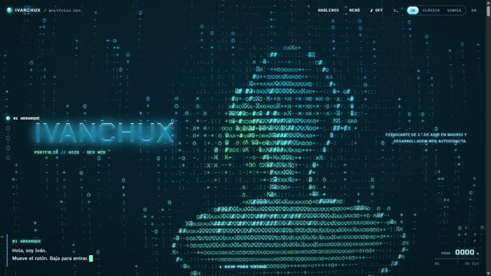</p>

HTML, CSS y JavaScript planos, sin frameworks. La versión 3D usa three.js (incluido en local, sin CDN). Una pequeña herramienta en Node genera las páginas a partir de los datos, y un editor visual local permite cambiar el contenido sin tocar JSON.

## Las tres versiones

| Dirección | Versión |
|---|---|
| `/` y `/en/` | **3D**: un viaje con scroll por capas (arranque → distritos de proyectos → sala de máquinas → descenso → contacto) |
| `/clasica/` | **Clásica**: el escritorio de los 90 original con monitor CRT donde se cargan los proyectos, y dentro IVANDEV OS |
| `/simple/` | **Simple**: una sola página ligera con todo, sin JavaScript ni animaciones |

### El viaje 3D

El viaje es un único camino continuo de cámara: **islas** (una por categoría) unidas por **puentes** que giran, suben y bajan, hasta una sala de máquinas cuyos brazos robóticos llevan a un chip.

| | |
|---|---|
| 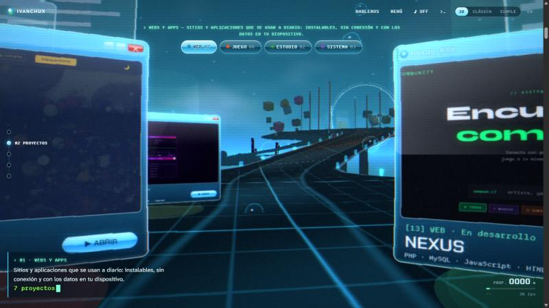 | 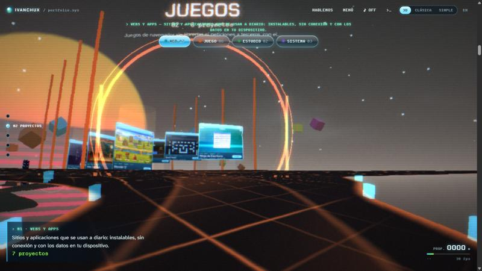 |
| **Islas.** Cada categoría es un lugar propio, teñido con el color de la categoría. Los paneles muestran la captura real de cada proyecto. | **Puentes.** Caminos estrechos y luminosos que giran, suben y bajan entre islas, atravesando una puerta con el nombre de la categoría. |
| 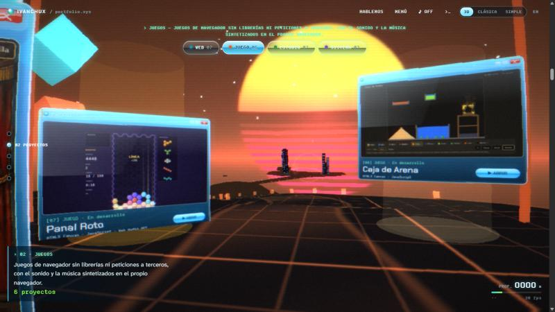 | 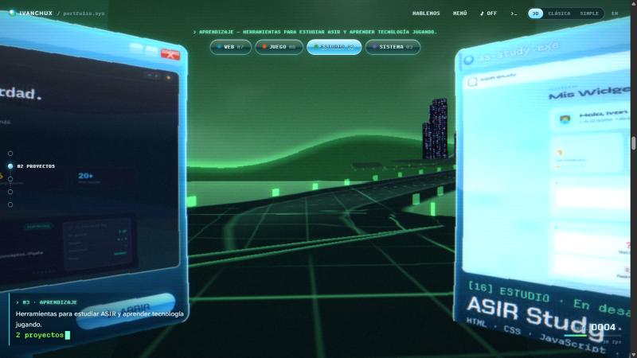 |
| **Juegos.** Una pista elevada sobre el vacío, con pilonos de neón, bloques flotantes y un sol arcade. | **Estudio.** Un valle verde con colinas, árboles, libros flotando y burbujas verdes. |
| 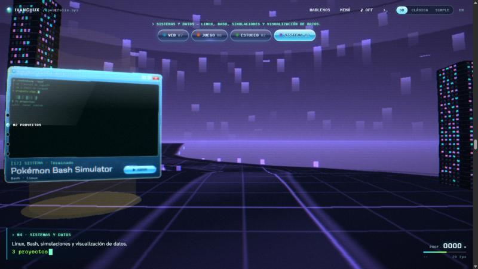 | 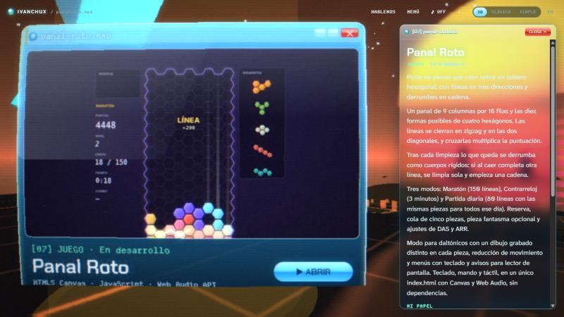 |
| **Sistemas.** Una nave de servidores con torres de LEDs, arcos de cables y lluvia de datos. | **Detalle de proyecto.** La cámara se acerca al panel; galería, papel, datos medidos y enlaces. Se comparte por URL (`#proyecto-…`). |
| 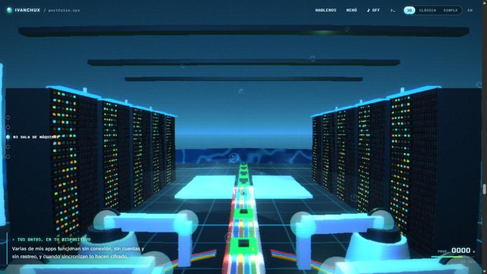 | 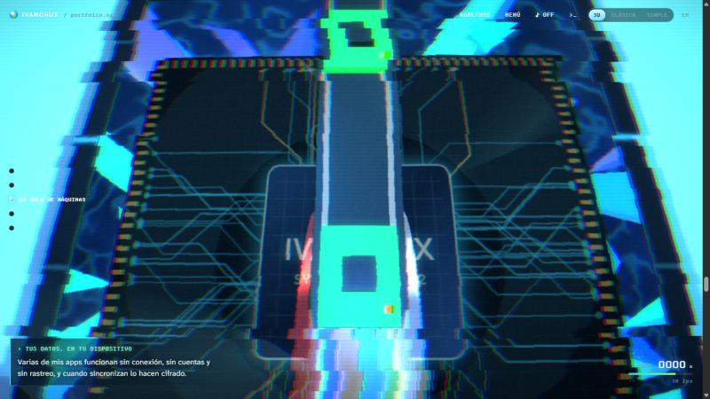 |
| **Sala de máquinas.** Los brazos se abren al pasar, siguen el cursor y se inclinan hacia la trampilla. | **Dentro del chip.** La trampilla se abre sobre un microprocesador; la cámara se sumerge en él con un destello digital. |
| 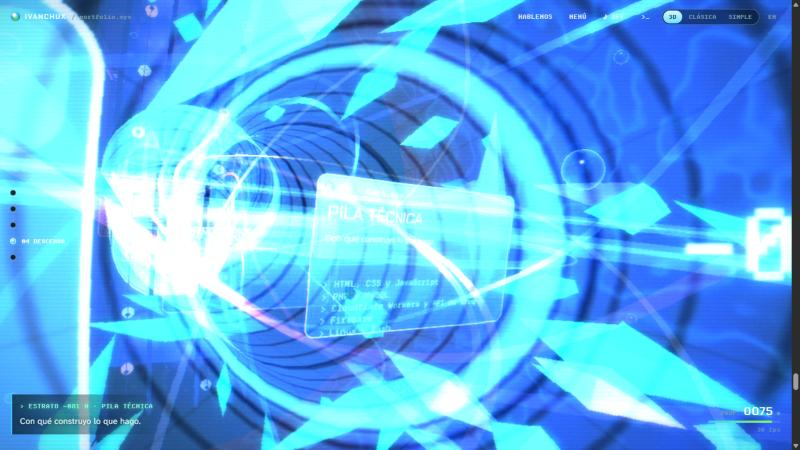 | 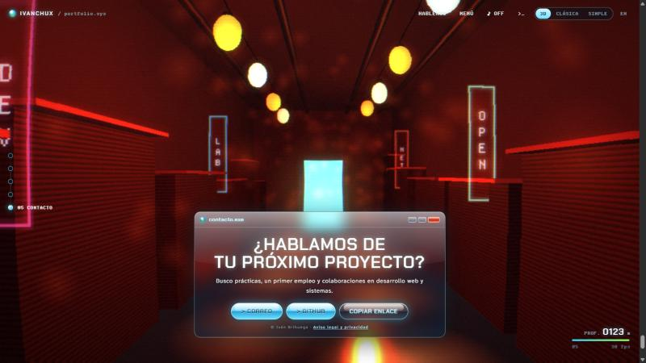 |
| **Túnel azul.** Solo se ve al entrar en el chip: un conducto de cristal costillado con fibras de colores y pulsos de luz. Dentro flota una capa por habilidad (clicables). | **Contacto.** El callejón rojo, con correo, GitHub y (cuando lo confirmes) LinkedIn. |

Además: consola oculta (tecla `` ` ``: `help`, `goto`, `open`, `stack`, `lab`, `os`…), sonido ambiente suave opcional que cambia ligeramente con la posición y la profundidad, navegación por teclado y soporte de `prefers-reduced-motion`. Sin WebGL ofrece la versión clásica.

### Versión clásica

<p align="center">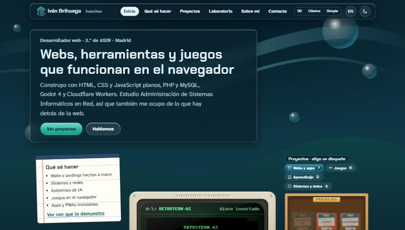</p>

### Versión simple

Una sola página ligera, sin JavaScript ni animaciones: todos los proyectos por categoría con su captura, habilidades, sobre mí y contacto. Pensada para conexiones lentas, imprimir o tecnologías de apoyo.

<p align="center">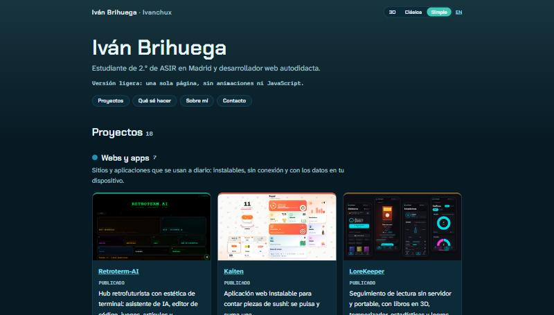</p>

## Editor visual

```bash
npm run editor      # o doble clic en Editor.bat en Windows
```

Se abre en `http://localhost:8090/` (solo en tu ordenador). Crea y edita proyectos, categorías, habilidades, «Sobre mí», datos del sitio y los textos de la 3D, en español e inglés. Arrastra las capturas (se convierten a WebP solas) y pulsa **Guardar y ver la web**: guarda, compila y actualiza una vista previa de las tres versiones, listando lo que sigue pendiente. Cada guardado conserva la versión anterior en `datos/.copias/`.

<p align="center">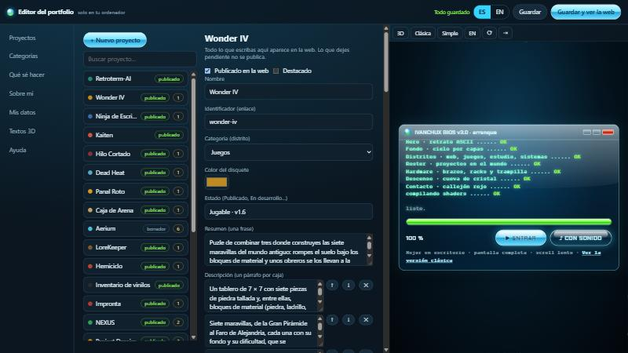</p>

## Requisitos

- **Node 22.12 o superior** (para compilar). Nada más: no hace falta `npm install`.
- Para los tests de IVANDEV OS, además, Playwright con Chromium.

## Comandos

| Comando | Qué hace |
|---|---|
| `npm run build` | Genera la web en `dist/` (clásica + 3D, en español e inglés) |
| `npm run editor` | Abre el editor visual en `http://localhost:8090` |
| `npm run subir` | Copia los cambios a tu clon del repositorio de GitHub, te los enseña y, si confirmas, hace commit y push (también `Subir-a-GitHub.bat`) |
| `npm start` | Compila y la sirve en `http://localhost:8080` |
| `npm test` | Compila y comprueba que no se publica nada pendiente, ni precios, ni recursos de terceros, ni cursor oculto |
| `npm run test:os` | Prueba IVANDEV OS en un navegador real |

En Windows, si el puerto 8080 está bloqueado, usa otro: `set PUERTO=5500` y después `npm start`.

### Abrir la web con doble clic, sin servidor

```bash
ARCHIVO=1 SALIDA=dist-archivo npm run build
```

En Windows (CMD): `set ARCHIVO=1` y `set SALIDA=dist-archivo`, y después `npm run build`. Abre `dist-archivo/index.html`. Funciona todo salvo IVANDEV OS, que necesita servidor: en ese caso se muestra su versión en HTML.

### Tests de IVANDEV OS

Dos de ellos escriben la frase del arranque secreto, que no está en el repositorio. Se pasa en la variable `OS_SECRETO` (está en tus notas internas). Sin ella esos dos tests se saltan y el resto se ejecuta.

## Dónde se cambia cada cosa

Todo el contenido vive en archivos de datos. No hay que tocar las páginas.

| Archivo | Qué contiene |
|---|---|
| `site.config.json` | Nombre, alias, dominio, correo, titular legal, GitHub y LinkedIn |
| `datos/proyectos.json` | Todos los proyectos. Solo se publican los que tienen `"publicar": true` |
| `datos/categorias.json` | Categorías de proyecto, con su color y su texto |
| `datos/habilidades.json` | «Qué sé hacer» y los proyectos que lo demuestran |
| `datos/sobre-mi.json` | Textos de «Sobre mí» |
| `datos/os-textos.json`, `datos/os-sistema.json` | Frases y archivos falsos de IVANDEV OS |
| `src/css/tokens.css` | Colores, tipografías y espacios de toda la web |
| `datos/en/` | Textos en inglés: proyectos, categorías, «Qué sé hacer», «Sobre mí» y el OS |
| `src/paginas/en/`, `src/plantillas/en/` | Páginas y plantillas en inglés |

**Dos idiomas.** `npm run build` genera la web en español en la raíz y la inglesa en `/en/`, con un botón ES/EN en la cabecera. Si un texto no tiene traducción en `datos/en/`, se usa el español.

**Cualquier valor `POR_CONFIRMAR` no se publica.** Al compilar se listan los que quedan.

### Añadir un proyecto

1. Copia una entrada de `datos/proyectos.json` y cambia `slug`, `nombre`, `categoria`, `resumen` y `descripcion`.
2. Pon sus capturas en `src/img/capturas/` (mejor en `.webp`) con su `ancho`, `alto` y un `alt` que describa la imagen.
3. Para que el monitor la cargue en vivo: `"vista_previa": { "tipo": "iframe", "url": "…", "formato": "escritorio" }`, o `"movil"` si es una app de móvil.
4. Pon `"publicar": true` y compila.

### Cuando tengas dominio

Escríbelo en `site.config.json` (por ejemplo `"dominio": "ivanchux.dev"`). Al compilar se generan solos `sitemap.xml`, las direcciones canónicas y las de Open Graph.

## Publicar en GitHub Pages

**Forma recomendada (GitHub Actions).** En *Settings → Pages → Source* elige **GitHub Actions**. Después, en la pestaña *Actions*, abre **«Publicar la web»** y pulsa **Run workflow**. GitHub compila la web con Node 22, pasa `npm test` y la publica. Si una comprobación falla, no se publica nada. El archivo es `.github/workflows/publicar.yml`; para que se publique solo con cada cambio, hay instrucciones dentro.

**Forma manual (rama `gh-pages`).** Alternativa si prefieres compilar tú:

La web es estática: basta con publicar la carpeta `dist/`. Una forma sencilla, sin herramientas extra:

1. Compila con `npm run build`.
2. Crea una rama `gh-pages` que contenga solo lo que hay dentro de `dist/`:
   ```bash
   git checkout --orphan gh-pages
   git rm -rf .
   cp -r dist/* .
   git add . && git commit -m "Publicación"
   git push origin gh-pages
   ```
   En Windows, usa el Explorador para copiar el contenido de `dist/` en lugar de `cp`.
3. En GitHub: *Settings → Pages → Source: Deploy from a branch → gh-pages / (root)*.
4. Para tu dominio: en esa misma pantalla, *Custom domain*, y en tu proveedor de dominio un registro `CNAME` apuntando a `ivanchux.github.io`.

Las rutas de la web son relativas, así que funciona tanto en `ivanchux.github.io/portfolio/` como en un dominio propio.

## Estructura

```
datos/            contenido (proyectos, categorías, textos)
herramientas/     build.mjs (web clásica), inmersivo.mjs (web 3D), editor.mjs + editor/ (editor visual), servir.mjs, iconos.mjs
src/inmersivo/    versión 3D: plantilla, CSS y JS por escenas (three.js en vendor/)
docs/capturas/    capturas que usa este README
src/paginas/      páginas
src/plantillas/   cabecera, pie, base y ficha de proyecto
src/css/          tokens, base, escritorio, páginas y fichas
src/js/           monitor, modos de color, animaciones y contacto
src/os/           IVANDEV OS (módulo y estilos)
src/fuentes/      tipografías con sus licencias
tests/            tests de la web y de IVANDEV OS
referencia/       material del portfolio anterior
```

## Accesibilidad y privacidad

- WCAG 2.1 AA: contraste comprobado, foco visible, todo usable con teclado y cursor del sistema.
- Con «reducir movimiento» activado no hay animaciones ni arranques.
- Sin cookies, sin analítica y sin recursos de terceros. Solo se guardan en el navegador el modo claro u oscuro y el color de la pantalla del monitor.

## Licencias

Tipografías bajo SIL Open Font License (ver `src/fuentes/`). Cada proyecto mostrado tiene su propia licencia en su repositorio.
