# Iván Brihuega's portfolio · Ivanchux

*[Versión en español: LEEME.md](LEEME.md)*

Personal portfolio website with **three versions of the same content**, switchable from the header: an immersive **3D journey**, the original **retro desk** with a CRT monitor, and a **simple** single page. Everything is generated from the same data files, in Spanish and English.

<p align="center">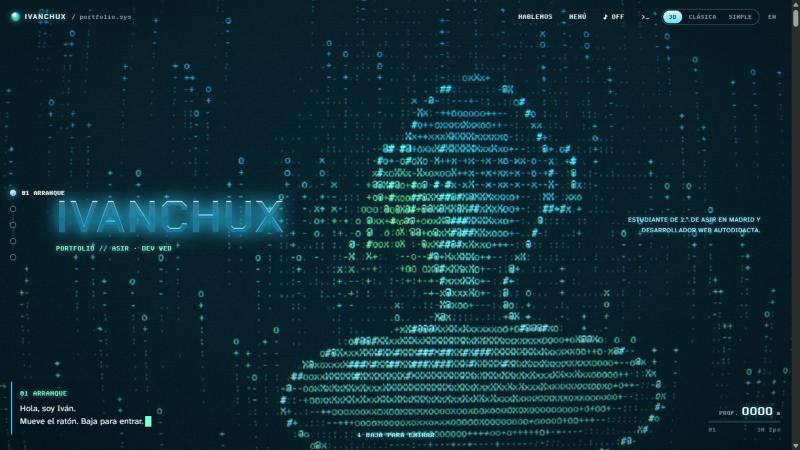</p>

Plain HTML, CSS and JavaScript, no frameworks. The 3D version uses three.js (bundled locally, no CDN). A small Node tool generates the pages from data files, and a local visual editor lets you change content without touching JSON.

## The three versions

| Address | Version |
|---|---|
| `/` and `/en/` | **3D**: a scroll journey through layers (boot → project districts → machine room → descent → contact) |
| `/clasica/` | **Classic**: the original 90s desk with a CRT monitor where projects load, and IVANDEV OS inside |
| `/simple/` | **Simple**: one light page with everything, no JavaScript or animations |

### 3D journey

The journey is a single continuous camera path: **islands** (one per category) joined by **bridges** that turn, climb and drop, ending in a machine room whose robotic arms lead down into a chip.

| | |
|---|---|
| 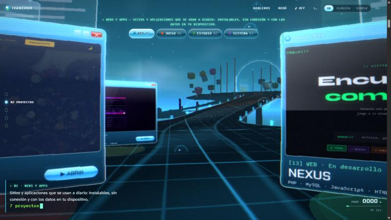 | 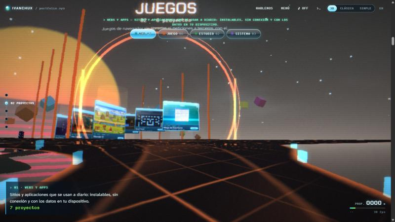 |
| **Islands.** Each category is a place of its own, tinted with the category colour. Panels show every project's real capture. | **Bridges.** Narrow glowing paths turn, climb and drop between islands, passing through a gate with the category name. |
| 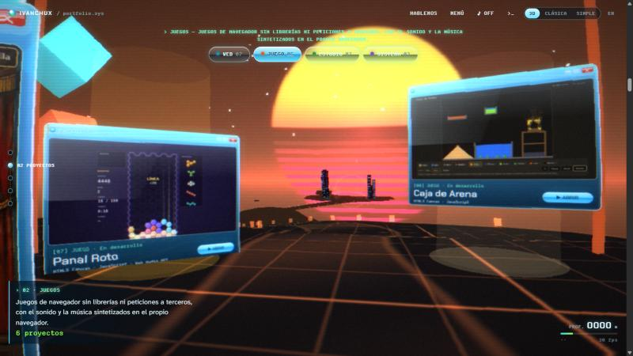 | 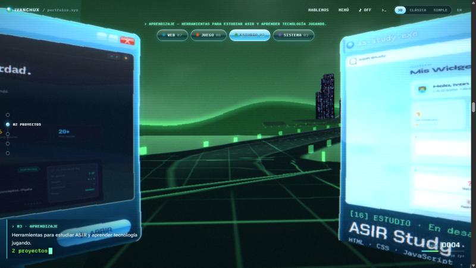 |
| **Games.** An elevated track over the void, with neon pylons, floating blocks and an arcade sun. | **Study.** A green valley with hills, trees, floating books and green bubbles. |
| 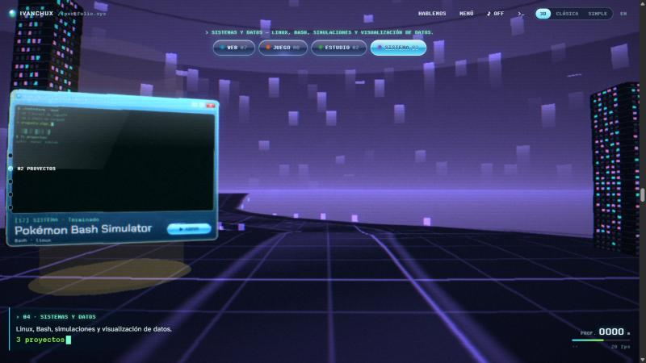 | 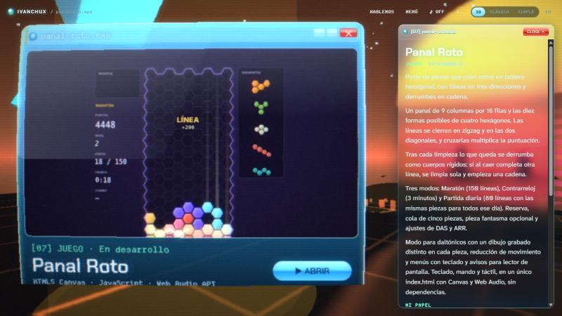 |
| **Systems.** A server hall with LED towers, cable arches and falling data. | **Project detail.** Camera dolly to the panel, gallery, role, measured results and links. Shareable by URL (`#proyecto-…`). |
| 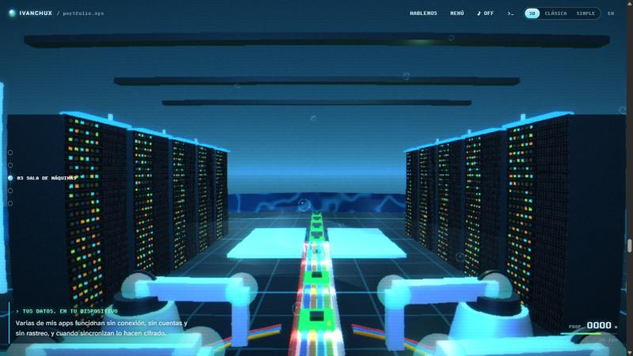 | 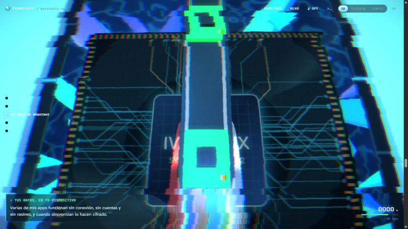 |
| **Machine room.** Robotic arms open as you pass, follow the cursor and lean towards the hatch. | **Into the chip.** The hatch opens onto a microprocessor; the camera dives into it with a digital flash. |
| 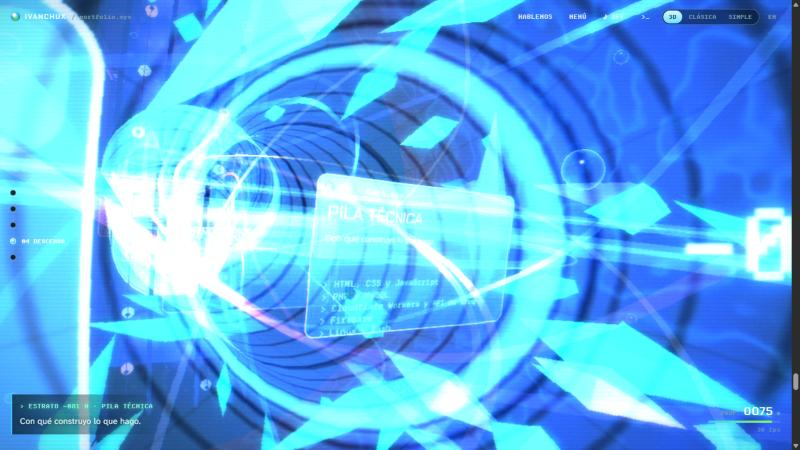 | 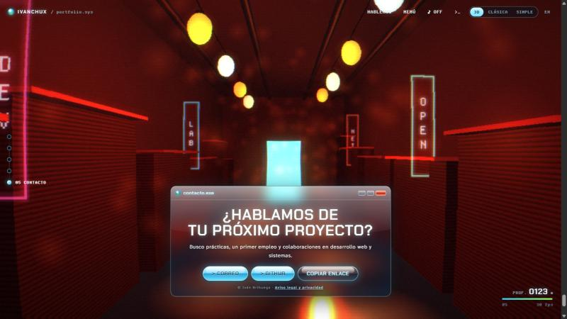 |
| **Blue tunnel.** Only visible once inside the chip: a ribbed glass conduit with coloured fibres and light pulses. One layer per skill floats inside (clickable). | **Contact.** The red alley, with email, GitHub and (once confirmed) LinkedIn. |

More: a hidden console (key `` ` ``: `help`, `goto`, `open`, `stack`, `lab`, `os`…), an optional soft ambient sound that shifts slightly with position and depth, keyboard navigation and `prefers-reduced-motion` support. Without WebGL it offers the classic version.

### Classic version

<p align="center">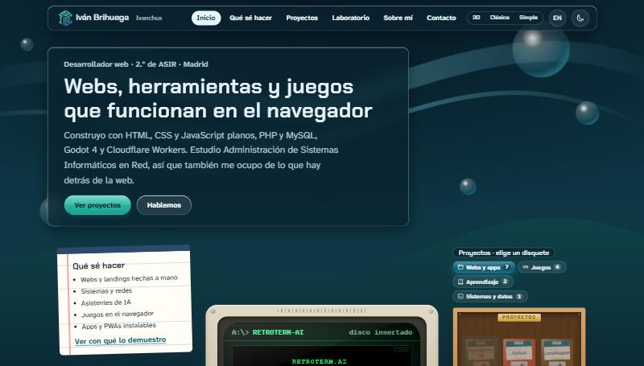</p>

### Simple version

A single light page, with no JavaScript or animations: every project by category with its screenshot, skills, about me and contact. Ideal for slow connections, printing or assistive technologies.

<p align="center">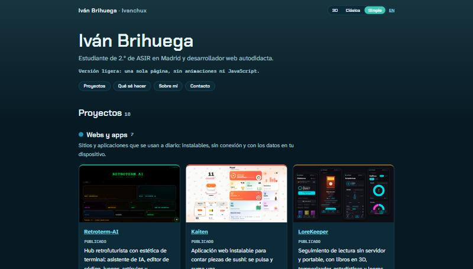</p>

## Visual editor

```bash
npm run editor      # or double-click Editor.bat on Windows
```

Opens `http://localhost:8090/` (only on your computer). Create and edit projects, categories, skills, "About me", site data and the 3D texts, in Spanish and English. Drag screenshots in (converted to WebP automatically), then **Save and view the site**: it saves, builds and refreshes a live preview of all three versions, listing what is still pending. Each save keeps the previous version in `datos/.copias/`.

<p align="center">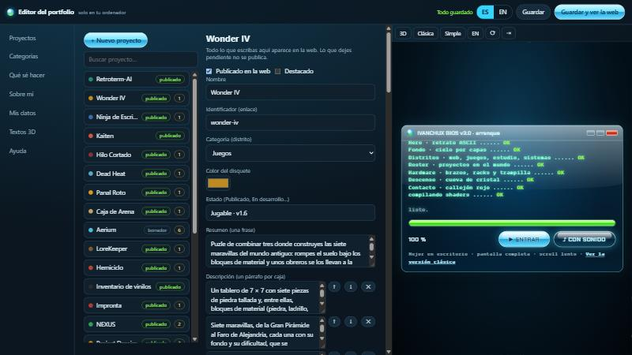</p>

## Requirements

- **Node 22.12 or later** (to build). Nothing else: no `npm install` needed.
- For the IVANDEV OS tests, Playwright with Chromium as well.

## Commands

| Command | What it does |
|---|---|
| `npm run build` | Generates the site in `dist/` (classic + 3D, Spanish and English) |
| `npm run editor` | Opens the visual editor at `http://localhost:8090` |
| `npm run subir` | Copies the changes to your clone of the GitHub repo, shows them and, if you confirm, commits and pushes (also `Subir-a-GitHub.bat`) |
| `npm start` | Builds and serves it at `http://localhost:8080` |
| `npm test` | Builds and checks that nothing pending, no prices, no third-party resources and no hidden cursor get published; also tests the 3D data and the editor's security |
| `npm run test:os` | Tests IVANDEV OS in a real browser |

On Windows, if port 8080 is blocked, use another one: `set PUERTO=5500`, then `npm start`.

### Open the site by double-clicking, without a server

```bash
ARCHIVO=1 SALIDA=dist-archivo npm run build
```

On Windows (CMD): `set ARCHIVO=1` and `set SALIDA=dist-archivo`, then `npm run build`. Open `dist-archivo/index.html`. Everything works except IVANDEV OS, which needs a server: its HTML version is shown instead.

### IVANDEV OS tests

Two of them type the secret boot phrase, which is not in the repository. It is passed in the `OS_SECRETO` variable. Without it those two tests are skipped and the rest run.

## Where to change things

All content lives in data files. Pages do not need to be edited.

| File | Contents |
|---|---|
| `site.config.json` | Name, alias, domain, email, legal owner, GitHub and LinkedIn |
| `datos/proyectos.json` | Every project. Only those with `"publicar": true` are published |
| `datos/categorias.json` | Project categories, with their colour and text |
| `datos/habilidades.json` | Skills and the projects that prove them |
| `datos/sobre-mi.json` | "About me" texts |
| `datos/os-textos.json`, `datos/os-sistema.json` | IVANDEV OS phrases and fake files |
| `src/css/tokens.css` | Colours, fonts and spacing for the whole site |
| `datos/en/` | English texts: projects, categories, skills, "About me" and the OS |
| `src/paginas/en/`, `src/plantillas/en/` | English pages and templates |

**Two languages.** `npm run build` generates the Spanish site at the root and the English one in `/en/`, with an ES/EN button in the header. Any text without a translation in `datos/en/` falls back to Spanish.

**Any `POR_CONFIRMAR` value is never published.** The build lists the ones left.

### Adding a project

1. Copy an entry in `datos/proyectos.json` and change `slug`, `nombre`, `categoria`, `resumen` and `descripcion`.
2. Put its screenshots in `src/img/capturas/` (preferably `.webp`) with their `ancho`, `alto` and an `alt` text describing the image.
3. To load it live in the monitor: `"vista_previa": { "tipo": "iframe", "url": "…", "formato": "escritorio" }`, or `"movil"` for a mobile app.
4. Set `"publicar": true` and build.

### Once you have a domain

Write it in `site.config.json` (for example `"dominio": "ivanchux.dev"`). The build then generates `sitemap.xml`, canonical URLs and Open Graph URLs on its own.

## Publishing on GitHub Pages

**Recommended way (GitHub Actions).** In *Settings → Pages → Source* choose **GitHub Actions**. Then, in the *Actions* tab, open **"Publicar la web"** and press **Run workflow**. GitHub builds the site with Node 22, runs `npm test` and publishes it. If a check fails, nothing is published. The file is `.github/workflows/publicar.yml`; instructions inside explain how to publish automatically on every change.

**Manual way (`gh-pages` branch).** An alternative if you prefer to build yourself:

The site is static: publishing the `dist/` folder is enough. A simple way, with no extra tools:

1. Build with `npm run build`.
2. Create a `gh-pages` branch containing only what is inside `dist/`:
   ```bash
   git checkout --orphan gh-pages
   git rm -rf .
   cp -r dist/* .
   git add . && git commit -m "Publish"
   git push origin gh-pages
   ```
   On Windows, copy the contents of `dist/` with File Explorer instead of `cp`.
3. On GitHub: *Settings → Pages → Source: Deploy from a branch → gh-pages / (root)*.
4. For your own domain: *Custom domain* on that same screen, and a `CNAME` record at your domain provider pointing to `ivanchux.github.io`.

All paths in the site are relative, so it works both at `ivanchux.github.io/portfolio/` and on a custom domain.

## Structure

```
datos/            content (projects, categories, texts)
herramientas/     build.mjs (classic site), inmersivo.mjs (3D site), editor.mjs + editor/ (visual editor), servir.mjs, iconos.mjs
src/inmersivo/    3D version: template, CSS and JS by scene (three.js in vendor/)
docs/capturas/    screenshots used in this README
src/paginas/      pages
src/plantillas/   header, footer, base layout and project page
src/css/          tokens, base, desk, pages and project pages
src/js/           monitor, colour modes, animations and contact
src/os/           IVANDEV OS (module and styles)
src/fuentes/      fonts with their licences
tests/            site and IVANDEV OS tests
referencia/       material from the previous portfolio
```

## Accessibility and privacy

- WCAG 2.1 AA: checked contrast, visible focus, fully keyboard usable and system cursor.
- With "reduce motion" on there are no animations or boot sequences.
- No cookies, no analytics and no third-party resources. Only the light or dark mode and the monitor's screen colour are stored in the browser.

## Licences

Fonts under the SIL Open Font License (see `src/fuentes/`). Each project shown has its own licence in its repository.
